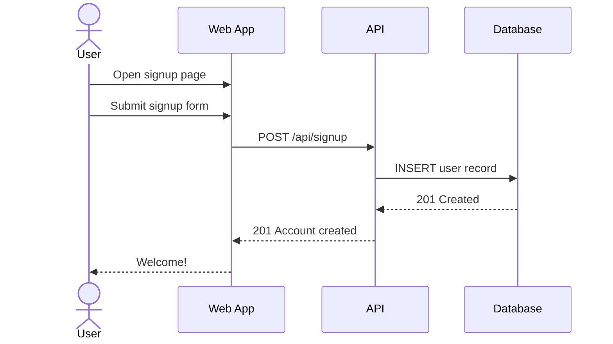
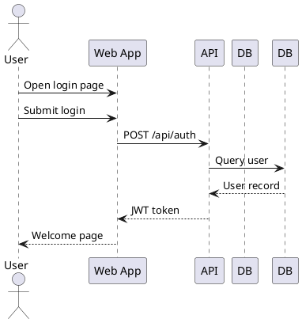
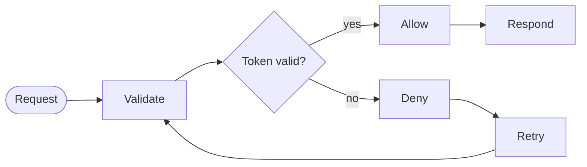
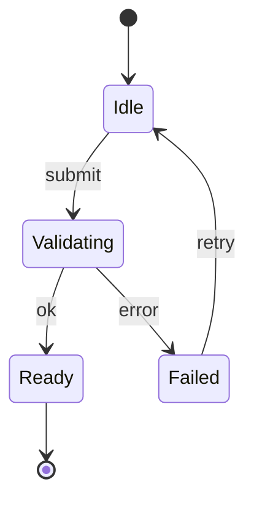

# Scene Syntax Reference

Scene is a presentation layer on top of Mermaid and PlantUML sequence diagrams that adds step-by-step animation, transition cards showing data state changes, and a traveller avatar that follows the conversation flow.

## Supported Formats

Scene supports two diagram formats:

| Format | Comment Prefix | Arrow Syntax | File Extension |
|--------|---------------|--------------|----------------|
| **Mermaid** | `%%` | `->`, `-->`, `->>`, `-->>`, `-x`, `--x`, `-)`, `--)`, `<<->>` | `.mmd`, `.scene` |
| **PlantUML** | `'` | `->`, `-->`, `->>`, `-->>`, `<-`, `<--`, `->x`, `->o` | `.puml`, `.plantuml` |

Format is auto-detected from the source: `@startuml` = PlantUML, `sequenceDiagram` = Mermaid.

Activation shorthand is understood on both sides — Mermaid's `A->>+B` / `B-->>-A` and PlantUML's `A -> B ++` / `A --> B --` — as are reversed arrows (`B <- A`, where the sender is on the right), gates (`[-> A`, `A ->]`), and quoted participant names.

## File Format
- Files use `.scene`, `.mmd`, or `.puml` extension
- Format is auto-detected from source (`@startuml` = PlantUML, `sequenceDiagram` = Mermaid)
- Scene annotations use the comment syntax for the active format:
  - Mermaid: `%% @directive`
  - PlantUML: `' @directive`

Scene works with Mermaid and PlantUML sequence diagrams. You write the diagram syntax you already know; Scene adds annotations and playback on top. For diagram syntax beyond what's shown here, see the [Mermaid docs](https://mermaid.js.org/syntax/sequenceDiagram.html) or [PlantUML docs](https://plantuml.com/sequence-diagram).

## Scene Annotation Directives

Every annotation block starts with `@step` and is placed directly above the Mermaid message line it describes.

### @step (required)
Starts a new annotation block. Each step needs a unique ID.
```
%% @step submit-signup
```
Also accepts JSON: `%% @step {"id":"submit-signup"}`

### @explain
Human-readable explanation of what this message represents.
```
%% @explain User submits the signup form
```

### @before
Description of the system state **before** this message executes.
```
%% @before Empty signup form
```

### @after
Description of the system state **after** this message executes.
```
%% @after Completed signup form with validated inputs
```

### @payload
Structured data payload displayed as JSON. Must be valid JSON.
```
%% @payload {"method":"POST","path":"/api/signup","body":{"email":"user@example.com"}}
```

### @note
Author note / reminder (not shown in presentation).
```
%% @note Verify rate limiting with platform team
```

### @duration
Playback duration for this step in milliseconds.
```
%% @duration 4000
```

## Complete Examples

### Mermaid


### PlantUML


## Flowcharts

Scene also animates Mermaid **flowcharts** (`flowchart LR|TB|TD|RL|BT`, or the
legacy `graph`). The kind is read from the header — a source with no header is
treated as a sequence diagram. Comments and directives are the same `%%` ones.

**Steps are edges.** Every edge (`A --> B`, `A -->|yes| B`) is one step, and its
`@step` block sits directly above the edge line. Nodes carry no annotations: a
block above a node declaration binds to the *next edge* and is reported as a
warning. Write one edge per line — chains (`A --> B --> C`) and `A --> B & C`
are not read as steps.

**Annotate every edge** with `@step`, `@explain`, `@before` and `@after`, exactly
like every message in a sequence diagram. Ask the user for the state before and
after an edge instead of inventing placeholders, unless they say to skip it.

**Playback follows source order.** Write edges in the order you want them told.

**Forks.** A node with two or more outgoing edges is a fork. Only one branch
plays per run: playback stops at the fork and asks which edge to take, with no default.
An edge reachable from only one branch plays only on that branch; edges after the
branches merge always play. Edge labels (`-->|yes|`) become the option names, so
label every edge out of a fork. A retry edge that loops back to the fork belongs
to the branch that loops.



## State diagrams

Scene also animates Mermaid **state diagrams** (`stateDiagram-v2` or
`stateDiagram`), detected from the header. They work exactly like flowcharts:

- **Steps are transitions.** Every `A --> B` or `A --> B : label` line is one
  step; put the `@step` block directly above it, one transition per line.
- **Annotate every transition** with `@step`, `@explain`, `@before` and `@after`.
  `@before` and `@after` should describe the state of the thing the diagram
  models. Ask the user instead of inventing placeholders.
- **`[*]` is a step endpoint like any other**: `[*] --> Idle` is the entry
  transition and `Ready --> [*]` the exit. Inside a composite `state X { ... }`
  block, `[*]` belongs to that composite.
- **Forks work the same way.** A state with two or more outgoing transitions is
  a fork: playback stops, asks which transition to take (no default), and plays
  one path. Label every transition out of a fork (`: ok`, `: error`) so the
  options have names.
- Playback follows source order. Notes (`note right of X ... end note`) and
  `direction` lines are not steps.



## Playback Controls

| Key | Action |
|-----|--------|
| `→` or `Space` | Next step |
| `←` or `Shift+Space` | Previous step |
| `Home` | First step |
| `End` | Last step |
| `P` | Play / Pause |
| `F` | Enter presentation mode |
| `Esc` | Exit presentation |
| `+` / `-` | Zoom in / out |
| `0` | Reset zoom |
| `O` | Toggle the step outline |
| `Shift` + arrows | Pan the diagram |

Plain arrows always step; hold `Shift` to pan instead. You can also drag to pan
and scroll to zoom.

## What Counts as a Step

**Every message in the diagram is a step** — annotated or not. Annotations do
not create steps; they attach an explanation and a card to a step that already
exists. A diagram with 22 messages and 17 `@step` blocks plays 22 steps, and
the 5 unannotated ones simply show no card.

These are drawn but are *not* steps: `activate` / `deactivate`, frames
(`alt`, `else`, `loop`, `par`, `opt`, `group`, `critical`, `break`),
notes, dividers (`--`), separators (`== title ==`), `title`, and participant
declarations.

Text inside a multi-line block is prose, not a message — so an arrow written
inside a `note` body is ignored:

```plantuml
note over App
  this A -> B is prose, not a step
end note
```

Careful with the bodyless forms: `title` alone on a line *opens* a multi-line
block that runs until `end title`, whereas `title My Diagram` is a one-liner.
The same applies to `header`, `footer`, `caption` and `legend`.

## Common Mistakes

Each of these is real parser behaviour, not a guess.

**An unclosed bodyless block kills the whole diagram.** `title` alone on a line
opens a block; if `end title` never arrives, every message after it is read as
prose and the diagram plays zero steps (play and next go dead). Same for
`note` / `header` / `footer` / `caption` / `legend`. Use
`title My Diagram` for a one-line title.

**`@payload` must be valid JSON on one line.** Invalid JSON is reported as an
error and kept as-is so you can fix it. Do not wrap it in code fences or split
it across lines.

**Step ids use letters, digits, `-` and `_` only.** A space or other
character is reported as an error.

**`@duration` must be a positive whole number of milliseconds.** `abc`, `0` and
negatives are reported as errors.

**Step ids must be unique.** A repeat is reported as an error. Both blocks still
attach, so playback keeps working, but fix the id.

**Two `@step` blocks with no message between them.** The first is dropped with
a warning — only the last one before a message attaches to it.

**A trailing `@step` after the last message attaches to nothing** and is
reported as a warning.

**Blank lines between an annotation block and its message are fine.** The block
attaches to the next message line, whatever comes in between.

**`@note` is an author note.** It is stored and round-tripped but never shown
during playback. Use `@explain` for anything the audience should read.

**`@duration` is the dwell time for that step in milliseconds** while
auto-playing. The traveller's travel animation is capped shorter than the dwell,
so a long duration means a longer pause, not a slower walk.

## Playback States

Each message is painted according to where playback has reached, so the covered
path is visible at a glance:

| State | Appearance |
|-------|------------|
| **Covered** (already played) | Green arrow, thickened |
| **Current** | Blue, bold and thick, with a glow; the traveller sits on it |
| **Upcoming** | Solid dark ink, full strength |
| **Skipped** | Red and dashed — a branch this run did not take |

Participants involved in the current step are highlighted in blue with a thick outline (every participant otherwise has its own colour),
at both the top and bottom of the diagram.

## Branches

`alt`, `opt` and `critical` mark alternatives: only one of them happens.
Playing them one after another would tell your audience that both did, so Scene
plays **one branch per run**.

- A chooser appears for each such frame. Pick a branch and the other branches'
  messages drop out of the step count and fade to the skipped style.
- **There is no default branch.** When playback reaches a fork (an `alt` with
  `else`, a `critical`, or a flowchart node with several outgoing edges) it
  stops and asks which path to take. Next and auto-play do nothing past that
  point until it is answered, and **both candidate paths light up on the
  diagram** so the question is answered where your audience is already looking.
- Once a path is chosen, playback follows it.
- Changing an answer later — from the bar at the bottom — **restarts from that
  fork** on the new path; answers to forks further on are cleared and asked
  again.
- `loop`, `par`, `group` and `break` are *not* alternatives. Their
  messages all play.

Nested frames work: a message plays only if every enclosing alternative frame
has its branch selected.

## Step Outline

Press `O` for a list of every step with its explanation. Click to jump.
Messages inside a frame are indented, steps with no `@explain` are marked, and
`@note` author notes appear here — the one place they are shown, since they are
for you rather than the audience.

## How It Works

1. **Traveller avatar** — A stick-figure avatar is automatically rendered on the diagram. When you step through annotations, it animates smoothly along the current arrow from the source actor to the target actor. No special Mermaid code is needed — the traveller appears whenever you have `%% @step` annotations.
2. **Step through** — Every message is a playback step. Press → or Space to advance. The traveller walks that arrow, the arrows behind it turn teal to mark the covered path, and the current one highlights in the accent colour.
3. **State cards** — `@before` and `@after` appear side by side in the presentation panel, which is draggable so you can park it clear of the diagram.
4. **Payload display** — `@payload` data is shown in the transition card (on the diagram) and in the presentation overlay.
5. **Presentation mode** — Full-screen view (press F). Keyboard-driven navigation with the explanation, state cards, and payload in an overlay panel. When you zoom in, the view follows the traveller so it never walks off screen.

## Creating a Scene Diagram (Step by Step)

To create an animated Scene diagram from scratch:

1. Start with `sequenceDiagram` as the first line.
2. Declare participants with `participant` or `actor`. Use `as` for display aliases.
3. For each message you want to animate, place an annotation block directly above the arrow line:
   - `%% @step unique-id` — REQUIRED. Starts the block. The ID must be unique.
   - `%% @explain What happens` — Describe the action in plain language.
   - `%% @before State description` — System state before this message.
   - `%% @after State description` — System state after this message.
   - `%% @payload {"key":"value"}` — Structured data (must be valid JSON).
   - `%% @duration 3000` — Optional step duration in milliseconds.
4. The traveller avatar and transition cards are created automatically. You do NOT need any special code for them.
5. Annotate the messages worth narrating. Unannotated messages still play as
   steps — they just show no card — so you do not need a `@step` for every
   arrow, and adding one never changes the step count.

**Important:** The traveller is automatic. Just write standard sequence diagram
syntax and put `@step` blocks above the arrows you want to narrate. Scene
handles the rest.

## Enforce @before / @after on every generated diagram

`@before`/`@after` state cards are what make a generated diagram legible to
someone who didn't write it — do not skip them by default.

- When generating a new Scene diagram, annotate **every message** with
  `@step`, `@explain`, `@before`, and `@after` — not just the ones that feel
  interesting.
- If you don't have enough context to state a real before/after system state
  for a message (e.g. the user hasn't described what the data looks like at
  that point), **ask the user** for that detail rather than inventing a vague
  placeholder like "state before" / "state after". The user can explicitly say
  to skip it for a given step (or for the whole diagram) — only omit
  `@before`/`@after` when they've said so.
- This applies to diagrams generated from scratch and to existing
  Mermaid/PlantUML diagrams being upgraded into Scene diagrams.
- In a flowchart or state diagram, "every message" means every edge or transition: each edge line gets
  `@step`, `@explain`, `@before` and `@after`, labelled or not.
